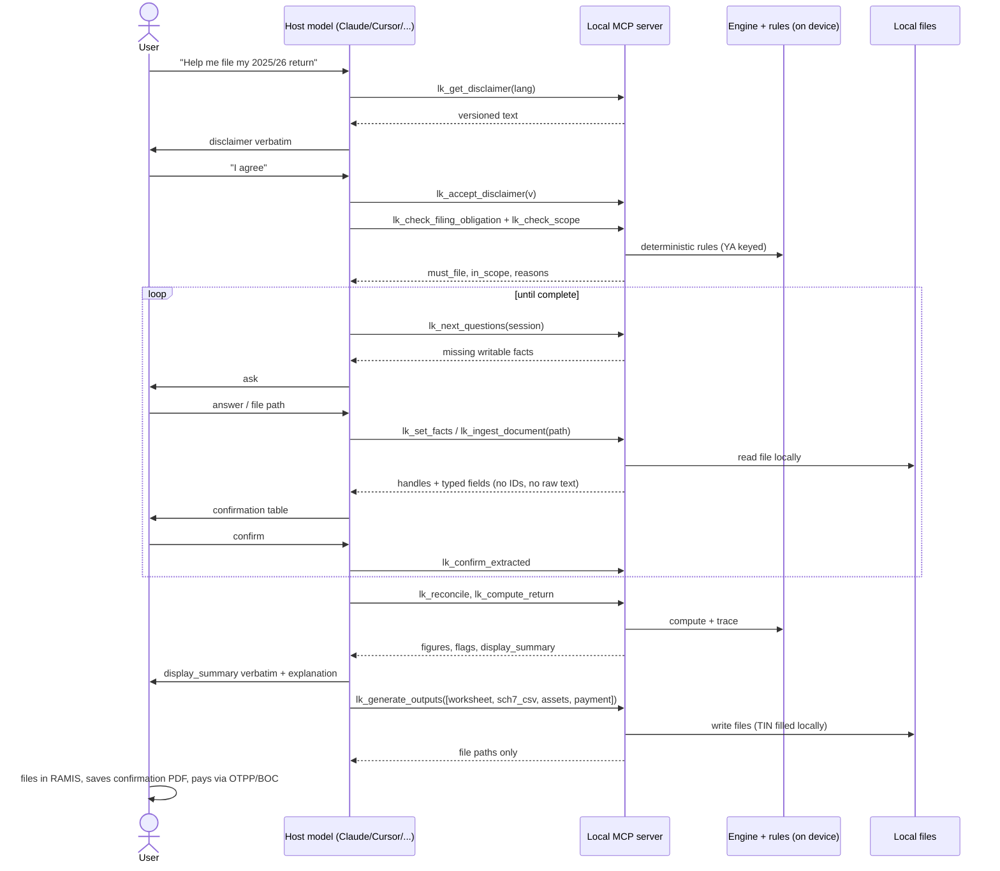
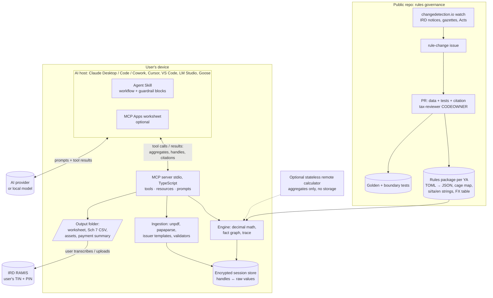

# Ship a Local Tax Engine Inside Assistants

**Build the plugin as a local, read-only MCP server that owns every rupee of arithmetic, with an Agent Skill that owns the conversation and outputs the user files themselves.** The evidence now supports that design end to end. The IRD's own YA 2025/26 return guide publishes six fully worked examples, and together with an AAT example, the instalment circular and two foreign-income calculators they give **12 golden test cases** a deterministic engine must match to the rupee ([IRD 2025/26 Guide](https://www.ird.gov.lk/en/Downloads/IT_Individuals_Doc/Asmt_IIT_004_2025_2026_E.pdf)). On the host side, Claude Desktop installs a `.mcpb` extension in one click on every plan, including Free, and it ships its own Node runtime, so users need no API key and no developer tools ([Claude Help](https://support.claude.com/en/articles/10949351-getting-started-with-local-mcp-servers-on-claude-desktop)). The same stdio server runs unchanged in Cursor, VS Code, LM Studio and Goose. The hard limits are outside the code. There is no RAMIS API for individuals, so the product stops at a cage-mapped worksheet, a Schedule 7 CSV, an asset statement and a payment summary ([IRD IIT 2024/25 guide](https://www.taxadvisor.lk/data/uploads/how_to_file_returns_individual_income_tax_iit_2024_2025.pdf)). Local MCP servers do not run in Claude web or mobile chat ([Claude plugin platform support](https://claude.com/docs/plugins/platform-support)). Anything a tool returns reaches the AI provider, so privacy has to be designed into the tool outputs. And one rule that decides the core segment's tax, the 15% cap on remitted foreign income when local income is small, is not settled by IRD. The YA 2025/26 return is due **30 November 2026**, six weeks from now. The realistic plan is a clearly labelled English preview covering triage, computation and worksheet for freelancers and remote workers by then, and a full, reviewed season release for YA 2026/27 by September 2027.

## Freelancers and remote workers carry the most new complexity

From 1 April 2025, foreign-currency service income, which was previously exempt, became taxable at a **"maximum rate of 15%"** if it is received in foreign currency and remitted through a bank ([Act No. 02 of 2025](https://documents.gov.lk/view/acts/2025/3/02-2025_E.pdf)). The IRD's Example 6 confirms that a remote employee of a US company qualifies for the same rate on salary, not just freelancers on business income ([IRD 2025/26 Guide](https://www.ird.gov.lk/en/Downloads/IT_Individuals_Doc/Asmt_IIT_004_2025_2026_E.pdf)). This group must now file, convert receipts at CBSL rates, split local from foreign income, claim credits and, from YA 2026/27, pay quarterly instalments under a new formula ([Circular SEC/2026/E/06](https://www.taxadvisor.lk/data/uploads/revised_circular_no_sec_2026_e_06_06_08_2026.pdf)). They are also the users most likely to already run Claude Desktop, Cursor or VS Code, which makes them the right first segment for a plugin. Salaried people with secondary income (rent, interest above Rs 5,000, a second employer, local service fees under the new 5% WHT) come second. Their computation is simpler, but their pain is certificate reconciliation. From YA 2025/26, employees with only APIT-covered employment income and interest of Rs 5,000 or less, and no instalment or final tax due, need not file at all ([KPMG June 2026](https://assets.kpmg.com/content/dam/kpmgsites/lk/pdf/kpmg-tax-news/2026/june/The_Inland_Revenue_Amending_Act_June_2026.pdf)). For most salaried users, "do I need to file?" is therefore the whole product.

The problem is procedural more than arithmetical. Only **25% of YA 2024/25 individual returns were filed on time** ([Daily FT](https://www.ft.lk/columns/Sri-Lanka-s-Personal-Income-Tax-squeeze/4-795176)). Users report PIN delays, bank AIT certificates missing the certificate numbers and dates IRD requires, and 12 rows per monthly-interest fixed deposit ([The Island](https://island.lk/the-need-to-submit-an-electronic-tax-return-and-its-challenges/)). Once submitted, a return cannot be viewed, printed or edited ([IRD IIT 2024/25 guide](https://www.taxadvisor.lk/data/uploads/how_to_file_returns_individual_income_tax_iit_2024_2025.pdf)). These facts set the product's job: decide obligation, gather and reconcile evidence, compute deterministically, and hand the user an artefact they can transcribe safely.

### Scope is decided by code, not by the model

The engine supports **resident individuals** with local employment income (APIT), foreign-employer employment income (APIT Table 08), sole-proprietor or freelance income entered as a **net figure the user supplies**, interest, rent, dividends (informational, final WHT), qualifying foreign income at the 15% cap, the standard reliefs and qualifying payments, APIT/AIT/WHT and simple foreign tax credits, and YA 2026/27 instalments. Everything else is refused or partially supported by a `check_scope` tool that returns `in_scope | partial | out_of_scope` with reason codes, and the compute tools refuse to run on `out_of_scope`. This follows HMRC's practice of publishing exclusions after a specification error ([Ross Martin](https://www.rossmartin.co.uk/private-client-a-estate-planning/income-losses-claims-reliefs/2634-software-specification-error-affects-2016-17-self-assessment)).

| Code | Condition (deterministic test) | Result | Basis |
|---|---|---|---|
| SC-01 | Not resident for the full YA, or a residency special case (overseas contract ≥1 year, ICRV holder, ship crew) | Out | Residency changes from 1 Apr 2025 ([KPMG](https://assets.kpmg.com/content/dam/kpmgsites/lk/pdf/kpmg-tax-news/2026/june/The_Inland_Revenue_Amending_Act_June_2026.pdf)) |
| SC-02 | Gains on realising investment assets | Out; refer to the separate 15% CGT return due within 30 days | Act 11/2026 ([KPMG](https://assets.kpmg.com/content/dam/kpmgsites/lk/pdf/kpmg-tax-news/2026/june/The_Inland_Revenue_Amending_Act_June_2026.pdf)) |
| SC-03 | Partnership or trust share (Sch 2/3 Part 1B/1C, cages 906, 907, 910) | Out | [IRD IIT 2024/25](https://www.taxadvisor.lk/data/uploads/how_to_file_returns_individual_income_tax_iit_2024_2025.pdf) |
| SC-04 | Betting, gaming, liquor or tobacco business (45%) | Out | [Act 02/2025](https://documents.gov.lk/view/acts/2025/3/02-2025_E.pdf) |
| SC-05 | Terminal benefits, lump sums, salary-arrears credit | Out (v1) | Separate Sch 8 bucket and APIT tables |
| SC-06 | Business income needing computation (depreciation, capital allowances, financial statements) or losses (Sch 10) | Partial: net profit accepted with a banner; losses out | Engine does not compute business profit |
| SC-07 | Foreign tax paid in more than one country, or claims beyond the s.80 cap | Partial: cap applied, flagged for review | FTC capped at attributable Sri Lankan tax ([IRD 2025/26 Guide](https://www.ird.gov.lk/en/Downloads/IT_Individuals_Doc/Asmt_IIT_004_2025_2026_E.pdf)) |
| SC-08 | Local taxable income below Rs 1M plus qualifying foreign income | Partial: computes the default model, shows both interpretations | Unresolved 15% edge case (see below) |
| SC-09 | Amended return, IRD assessment or appeal; a practitioner preparing for clients | Out / partial with a PDPA controller notice | No documented individual amendment flow |

## The journey ends at the user's own RAMIS login

The journey below maps each stage to the MCP tool that serves it and to the RAMIS screens and cages the IRD documents. Screen names come from the YA 2024/25 e-filing guide, which IRD still links for the YA 2025/26 season ([IRD homepage](https://www.ird.gov.lk/en/sitepages/default.aspx)). Cage numbers come from the YA 2025/26 return guide.

| # | Stage | What happens | Tools | RAMIS screen / cages |
|---|---|---|---|---|
| 1 | Install | One-click `.mcpb` in Claude Desktop; plugin in Claude Code/Cowork; `npx` config in Cursor/VS Code/LM Studio. Identifiers (name, TIN, NIC) go into local extension settings, never chat | — | — |
| 2 | Consent | Versioned disclaimer shown verbatim; the server refuses ingest and compute until it is accepted; disclosure of what reaches the AI provider | `lk_get_disclaimer`, `lk_accept_disclaimer` | Declaration Part A "preparer" stays blank (the user is the preparer) |
| 3 | Triage | Filing obligation per YA; TIN, PIN and IIT tax-type activation checklist; scope gate | `lk_check_filing_obligation`, `lk_check_scope` | e-Services → Taxpayer Registration → Tax type Registration Request |
| 4 | Interview | Asks only for facts that currently decide incomplete results | `lk_next_questions`, `lk_set_facts` | Standard: residency and senior-citizen flags; income-source ticks decide Simplified vs Standard |
| 5 | Ingest | Local parse of T-10, bank AIT/WHT certificates, Wise/Payoneer CSV; returns typed fields only | `lk_ingest_document`, `lk_confirm_extracted`, `lk_convert_fx` | Sch 1 (T-10 A–E), Sch 3, Sch 4, Sch 7A |
| 6 | Reconcile | Flags APIT mismatches, missing certificate numbers or dates, unconverted FX, duplicate FD rows, missing remittance evidence | `lk_reconcile` | Sch 7 rows (701 source codes), Sch 9 cages 903/904/908 |
| 7 | Compute | Deterministic return with status (complete, placeholder, incomplete) and flags | `lk_compute_return` | Cages 10–50, 60–110, 120, Sch 8 (809A/809B), 170, 180, 190/200 |
| 8 | Explain | Per-line trace with rule id, version and citation; the model narrates and does not recompute | `lk_explain` | — |
| 9 | Outputs | Worksheet in RAMIS order, Schedule 7 CSV, asset statement, payment summary, walkthrough, written to a local folder | `lk_generate_outputs`, `lk_get_ramis_walkthrough` | Main Return, Sch 1–9, Statement of Assets & Liabilities (Parts 01 A–D, 02 A–B) |
| 10 | File | User logs in with TIN + PIN + CAPTCHA, enters cages, uploads CSV after the IRD verifier, **saves the confirmation PDF before Submit**, uploads T-10s | Walkthrough only | Return/Schedule Mgmt → IIT → YA → Proceed → Declaration → Confirmation → Submit → Document Upload |
| 11 | Pay | Tax type 05, period code 25260 for the YA 2025/26 final payment, via OTPP or Bank of Ceylon with the DIN | `lk_generate_outputs` (payment) | OTPP: TIN, Taxable Period, Tax Type, Payment Type, voucher |
| 12 | Instalments | YA 2026/27 (A − C) ÷ B, due 15 Aug, 15 Nov, 15 Feb, 15 May; next year's carry-forward from the encrypted session export | `lk_plan_instalments` | Period code 26271 (instalment 1); later codes inferred |

Three journey facts matter for design. First, the **balance of YA 2025/26 tax was due 30 September 2026**, before the return ([Regfollower](https://regfollower.com/sri-lanka-ird-reminds-businesses-individuals-of-2025-26-tax-deadline/)). Most users filing in November therefore already owe late-payment interest, and the payment summary must say so. Second, the OTPP flow asks for TIN, taxable period, tax type and payment type, then validates against IRD before the payer picks a voucher ([IRD OTPP guide](http://www.ird.gov.lk/en/eServices/Lists/PaymentRefund/Attachments/7/User_Guide_for_IRD_Online_Payment_E.pdf)). The summary can give exact field values, but it never touches payment. Third, the Schedule 7 CSV must be named in the pattern `<TIN>_IIT_WHTSCHEDULE_<YA>_<date>_ORIGINAL_V<n>` and checked with the IRD Schedule File Verifier, which was updated on 1 April 2026. Its column specification has not been obtained ([IRD IIT 2024/25 guide](https://www.taxadvisor.lk/data/uploads/how_to_file_returns_individual_income_tax_iit_2024_2025.pdf); [IRD homepage](https://www.ird.gov.lk/en/sitepages/default.aspx)).

## Requirements stay functional, testable and tied to sources

### Functional requirements

| ID | Requirement |
|---|---|
| FR-1 | Determine for a selected YA whether the user must register, activate the IIT tax type and file, including the YA 2025/26+ APIT-only and interest ≤ Rs 5,000 exemption |
| FR-2 | Run a deterministic scope check (SC-01…SC-09) before any computation and block computation for out-of-scope cases with a referral message |
| FR-3 | Present a server-enforced, versioned consent and disclosure step before any data entry or ingestion, and record acceptance locally |
| FR-4 | Drive the interview from missing facts only, never re-asking confirmed facts |
| FR-5 | Capture income by category: employment (primary, secondary, foreign employer), business net profit, interest, rent, dividends, and foreign receipts with currency, date, remittance and use-outside-Sri-Lanka flags |
| FR-6 | Ingest T-10 certificates, bank AIT/WHT certificates and Wise/Payoneer statements locally, returning typed fields with confidence and source location |
| FR-7 | Require explicit user confirmation of every extracted value before it is used |
| FR-8 | Convert foreign amounts at a dated CBSL rate per receipt, with a user override (actual bank rate) recorded with an audit note |
| FR-9 | Reconcile evidence: APIT vs T-10, AIT vs rate × interest, missing certificate fields, duplicate rows, unremitted foreign income |
| FR-10 | Compute the full return: assessable income per source, reliefs and qualifying payments with caps and carry-forwards, taxable income split into progressive and 15% buckets, credits, balance payable or refund |
| FR-11 | Explain any output line with rule id, rule version, formula, inputs and IRD or statute citation |
| FR-12 | Emit engine flags: `needs_professional_review`, `estimate`, `provisional_rules`, interpretation alternatives (15% edge case) |
| FR-13 | Generate a cage-mapped worksheet in RAMIS screen order for Simplified or Standard returns |
| FR-14 | Generate a Schedule 7 CSV in the IRD naming pattern that passes the IRD verifier |
| FR-15 | Capture and output the Statement of Assets and Liabilities, carried forward from the prior year |
| FR-16 | Generate a payment summary (tax type, period code, channels, DIN steps, due dates, late-payment exposure) |
| FR-17 | Compute YA 2026/27 instalments under Methods 1 and 2 and produce a dated schedule |
| FR-18 | Estimate late filing and payment penalties and interest, labelled as estimates |
| FR-19 | Provide a screen-by-screen RAMIS walkthrough and a pre-export verification checklist |
| FR-20 | Save an encrypted session file, reload it next year, and wipe all local data on request |
| FR-21 | Serve fixed text (disclaimers, labels, errors, summaries) in si, ta and en, keeping official English RAMIS terms alongside |
| FR-22 | Publish supported scenarios, known issues and rule sources as readable resources |

### Non-functional requirements

| ID | Area | Requirement |
|---|---|---|
| NFR-1 | Accuracy | 100% exact match on all golden cases; every rule value cites a source; CI blocks uncited or out-of-order versions; the model never performs tax arithmetic |
| NFR-2 | Accuracy | Prior-YA test suites are frozen; a change for a new YA cannot alter earlier outputs |
| NFR-3 | Privacy | No NIC, TIN, name, employer name or account number in any tool result; raw document text never returned; output filter blocks identifier patterns |
| NFR-4 | Privacy | No telemetry, crash upload or identifying update checks; all data in one local directory, encrypted at rest |
| NFR-5 | Security | stdio transport by default; no outbound network from the server; no shell, no `eval`, no tool that fetches URLs or writes outside its directories |
| NFR-6 | Security | Static tool definitions with a published manifest hash; signed `.mcpb`, npm provenance, lockfile hashes, SBOM, SECURITY.md |
| NFR-7 | Localisation | si/ta/en strings reviewed by native, tax-literate reviewers; LKR formatting consistent; evals include code-mixed Sinhala and Tamil |
| NFR-8 | Offline | Full computation, ingestion (text-layer PDFs, CSV) and output generation work with no network; FX table bundled per YA |
| NFR-9 | Performance | Core tools respond in under 1 s on a mid-range laptop; a full journey uses at most about 25 tool calls; a lite profile of 8 or fewer tools fits small local-model contexts |
| NFR-10 | Maintainability | Law changes are data and test edits only; rule data is language-neutral and shareable with `lk-tax` |
| NFR-11 | Compliance | No login, scraping, credential storage or submission; "not IRD-approved, not advice" on every output; YA, rule version and verified date printed on every output |
| NFR-12 | Portability | Runs in Claude Desktop (macOS, Windows), Claude Code/Cowork, Cursor, VS Code, LM Studio and Goose without code changes; degrades gracefully where MCP Apps or elicitation are missing |
| NFR-13 | Accessibility | HTML outputs target WCAG 2.2 AA with lang attributes and Unicode Sinhala/Tamil fonts; printable |

The performance targets in NFR-9 are design targets, not measured figures.

## The architecture keeps numbers and identifiers on the device

The design has six parts. A **rules package** holds language-neutral data. A **deterministic engine** reads it. An **ingestion pipeline** and an **encrypted session store** sit beside the engine. A **stdio MCP server** exposes the engine, and an **Agent Skill** scripts the conversation. Packaging and two optional hosts (an MCP Apps worksheet and a stateless remote calculator) sit at the edge.

### What reaches the AI provider and what never does

Whatever a tool returns enters the conversation and goes to the provider. Claude consumer accounts retain chats for 30 days, or five years if the user allows training ([Anthropic](https://www.anthropic.com/news/updates-to-our-consumer-terms)). Minimisation therefore has to happen inside the server.

| Reaches the provider (cloud host) | Never reaches the provider (by construction) | Depends on user choice |
|---|---|---|
| User's chat messages; tool inputs the model sends (amounts, dates, YA, yes/no facts, file paths) | NIC, TIN, name (entered in `.mcpb` `user_config` marked `sensitive`, stored in the OS keychain) | Attaching a document to chat so the model reads it (explicit fallback, warned) |
| Tool results: handles (`emp_1`), category totals, flags, rule ids and citations, `display_summary` | Employer and bank names, account and certificate numbers (kept in the session store against handles) | Skill-only variant in Claude web/mobile: computation runs in the provider's sandbox |
| Explanations of rules | Raw PDF or CSV text; generated worksheets and CSVs (returned as file paths only) | Optional remote calculator: receives aggregates, no identifiers |
| — | Anything at all when the host runs a local model (LM Studio, Goose with Ollama) | — |

This design also removes the "external communication" leg of the lethal trifecta inside the server. Because it holds private data and reads untrusted documents, it must have no way to send data out ([Simon Willison](https://simonwillison.net/2025/Jun/16/the-lethal-trifecta/)). Ingested documents only ever produce schema-validated fields, which blocks instructions embedded in PDFs. The remaining risk is another MCP server the user has installed alongside, and the documentation must say so. The "never reaches" column is a design guarantee only against this server: a user who types a NIC into chat defeats it, so the Skill must also tell the model not to ask for identifiers.

### MCP tool, resource and prompt catalogue

Tool names carry an `lk_` prefix to avoid collisions in multi-server hosts, in the spirit of the payslip MCP's `verb_sri_lanka_noun` convention ([sri-lanka-salary-calculator](https://github.com/Buddhima-JD3/sri-lanka-salary-calculator)). Every tool is annotated read-only and non-open-world, declares an `outputSchema`, returns `structuredContent` plus a text fallback ([MCP Tools spec](https://modelcontextprotocol.io/specification/2025-11-25/server/tools)), and includes `caution`, `sources[]`, `ruleset_version` and `ya`. File inputs are paths passed as arguments, because the 2026-07-28 specification deprecates roots, sampling and server-initiated elicitation ([MCP 2026-07-28 changelog](https://modelcontextprotocol.io/specification/2026-07-28/changelog)).

| Tool | Purpose | Lite profile |
|---|---|---|
| `lk_get_disclaimer` / `lk_accept_disclaimer` | Versioned, localised disclaimer; records acceptance; gates other tools | ✓ (merged) |
| `lk_check_filing_obligation` | Must register / activate / file, per YA | ✓ |
| `lk_check_scope` | SC-codes, `in_scope`, `partial` or `out_of_scope`, referral text | ✓ |
| `lk_session` | Start, load prior-year export, save draft (opt-in), wipe | ✓ |
| `lk_next_questions` | Missing writable facts that decide incomplete results | ✓ |
| `lk_set_facts` | Validated fact entry with handle return | ✓ |
| `lk_ingest_document` | Local parse of a file path → typed fields, confidence, redacted snippet | |
| `lk_confirm_extracted` | User-confirmed values become facts | |
| `lk_convert_fx` | CBSL-dated conversion or bank-rate override with trace | |
| `lk_reconcile` | Cross-document checks and missing-evidence list | |
| `lk_compute_return` | Full computation; `response_format` concise or detailed | ✓ |
| `lk_explain` | Trace for a cage, line or rule id | ✓ |
| `lk_plan_instalments` | YA 2026/27 (A − C) ÷ B schedule, Methods 1 and 2 | |
| `lk_estimate_penalties` | s.178/s.179 and interest estimate | |
| `lk_generate_outputs` | Worksheet, Sch 7 CSV, asset statement, payment summary → file paths | ✓ (merged) |
| `lk_get_ramis_walkthrough` | Screen-by-screen steps for this session | |

Resources: `lktax://rules/{ya}`, `lktax://sources/{ya}`, `lktax://cagemap/{ya}`, `lktax://checklist/documents`, `lktax://known-issues`, and `ui://worksheet` for MCP Apps. Prompts: `file_my_return`, `do_i_need_to_file`, `plan_my_instalments`, `explain_my_tax`. The prompts mirror the Skill, so hosts without Skills (Claude Free, Cursor, LM Studio) still follow the journey.

**Agent Skill.** A `SKILL.md` under 500 lines, per the Agent Skills specification ([agentskills.io](https://agentskills.io/specification)), written as modular blocks: role, workflow state machine, guardrails, consent checkpoints, escalation and RAMIS reference. It must contain **no numeric rates**, so the prompt can never drift from the engine. It instructs the model to present `display_summary` verbatim, never to add, multiply or round an LKR amount, and to stop when the engine returns `isError` instead of falling back to remembered rates. This matters because frontier models scored at best **32% strictly correct** on simple US returns in TaxCalcBench, mostly through table misuse and cascading arithmetic errors ([TaxCalcBench](https://arxiv.org/html/2507.16126v1)).

**Packaging.** Ship one TypeScript codebase in four forms:

- an npm package for `npx`;
- a signed `.mcpb` with `user_config` for the data directory, output directory, sensitive identifiers and tool profile ([mcpb manifest](https://github.com/modelcontextprotocol/mcpb/blob/main/MANIFEST.md));
- a Claude plugin bundling the Skill and server through a marketplace repo ([Claude Code plugins](https://code.claude.com/docs/en/plugins));
- a `server.json` in the MCP Registry, which is in preview and feeds aggregators ([MCP Registry](https://modelcontextprotocol.io/registry/about)).

Privately distributed `.mcpb` files do not auto-update. Directory-listed ones do, so submitting to the Claude extension directory is the way to push in-season rule fixes ([Claude Help](https://support.claude.com/en/articles/10949351-getting-started-with-local-mcp-servers-on-claude-desktop)).

**Optional MCP Apps worksheet.** MCP Apps render a sandboxed `ui://` HTML resource in Claude web and Desktop, VS Code, Cursor, Goose and ChatGPT ([MCP client matrix](https://modelcontextprotocol.io/extensions/client-matrix)). App-only tools (`visibility: ["app"]`) let the user confirm extracted values and tick the consent box in a form that never passes through the model ([MCP Apps API](https://apps.extensions.modelcontextprotocol.io/api/documents/Overview.html)). Whether hosts log app-only results is undocumented, so treat this as progressive enhancement: the text path must stay complete on its own.

**Optional stateless remote calculator.** A rules-and-compute endpoint that accepts only aggregates (`compute`, `explain`, `plan_instalments`, `get_rules`) and keeps no request bodies. It is the only route into ChatGPT, which connects only to remote HTTPS servers, offers developer mode on the web only, and gives full MCP to Business, Enterprise and Edu plans ([OpenAI Help](https://help.openai.com/en/articles/12584461-developer-mode-apps-and-full-mcp-connectors-in-chatgpt-beta)). Running it makes AppKade a likely PDPA controller or processor once Part III commences on **1 January 2027** ([Daily FT](https://www.ft.lk/front-page/Data-protection-compliance-regime-takes-effect-on-1-Jan-2027/44-795776)). It therefore needs a privacy notice, a DPIA-lite and a legal opinion before launch.

### How each host fits

| Host | How it runs | Status for this product |
|---|---|---|
| Claude Desktop (all plans, incl. Free) | `.mcpb`, built-in Node; MCP Apps supported | **Primary** |
| Claude Code, Cowork (on-device) | Plugin: Skill + local MCP | Primary for power users |
| Claude web and mobile chat | Local MCP and `.mcpb` are **ignored**; Skills need Pro+ with code execution; remote connectors only ([platform support](https://claude.com/docs/plugins/platform-support); [Skills](https://support.claude.com/en/articles/12512180-using-skills-in-claude)) | Later: Skill-only sandbox variant or remote calculator, with privacy note |
| Cursor, VS Code (Copilot) | stdio; prompts, resources, elicitation, MCP Apps ([Cursor](https://cursor.com/docs/context/mcp); [VS Code](https://code.visualstudio.com/docs/copilot/customization/mcp-servers)) | Supported from day one via `npx` |
| LM Studio ≥0.3.17, Goose + Ollama | Local MCP host with local models ([LM Studio](https://lmstudio.ai/docs/app/mcp); [Goose](https://block.github.io/goose/docs/getting-started/providers)) | **Fully on-device mode**; lite profile; weaker Sinhala/Tamil |
| ChatGPT | Remote HTTPS only; developer mode web-only, paid tiers | Phase 3 via stateless remote calculator |
| Gemini CLI → Antigravity CLI | Extensions bundle MCP and Skills; Gemini CLI retired for unpaid tiers on 18 Jun 2026 ([Gemini CLI docs](https://geminicli.com/docs/extensions/)) | Best effort, untested |
| Thin web UI | Same engine compiled for the browser, encrypted local storage | Phase 3 for non-assistant users |

### Technology choices follow the host, not the team's habit

**TypeScript** replaces the Python/Pyodide engine that the earlier PWA-first recommendation proposed. Claude Desktop ships Node, so a pure-JS `.mcpb` needs no install. The MCP Apps SDK is TypeScript. The MCPB documentation warns that compiled Python dependencies such as pydantic "can't be bundled portably" ([mcpb](https://github.com/modelcontextprotocol/mcpb)). Money uses **decimal.js or bigint cents, never floats**, copying `lk-tax`'s `Decimal` discipline ([lk-tax](https://github.com/ShalomHunukumbura/lk-tax)). Minimal dependencies keep the bundle small: the MCP SDK, zod, unpdf (2.2 MB unpacked) and papaparse (0.27 MB). pdfjs-dist (34.9 MB) and the AGPL PyMuPDF are avoided, and OCR ships as a separate opt-in extension. The end-to-end bundle size has not been measured.

**Reuse from `lk-tax`:** its effective-dated TOML rule files with IRD citations, its `select_version` logic, its citation-lint and ordering tests, and its official APIT Table 01 fixtures. Compile TOML to JSON in CI and propose co-maintaining the rules directory upstream. Its engine only applies relief and bands to one number, with no income categories, 15% cap, credits or instalments, so the annual-return engine is new work in any language ([lk-tax](https://github.com/ShalomHunukumbura/lk-tax)). **Reuse from Buddhima's payslip MCP:** read-only annotations, zod schemas with `structuredContent`, `caution` and `sources[]` on every result, a checklist tool, `server.json` with both stdio and remote entries, and CalVer tied to the YA (`2026.27.x`). Do not reuse its 76-line engine, which uses floats and hard-codes one year ([sri-lanka-salary-calculator](https://github.com/Buddhima-JD3/sri-lanka-salary-calculator)).

**Fact-graph engine with traces.** Borrow from the IRS Fact Graph, which is CC0. Each fact is writable or derived, results are Complete, Placeholder or Incomplete, and explanations include "only children that are at present determining the result", which yields the next interview question without redundant tool calls ([IRS Fact Graph](https://github.com/IRS-Public/fact-graph/blob/main/shared/src/main/scala/gov/irs/factgraph/Explanation.scala)). Borrow from OpenFisca the practice of attaching a legal reference to every dated parameter value ([OpenFisca](https://openfisca.org/doc/coding-the-legislation/legislation_parameters.html)). Each node returns `{value, status, trace{ruleId, version, sources, inputs, formula, children}}`. Catala is self-described as an unstable research compiler and is not worth its toolchain for a small plugin ([Catala](https://github.com/CatalaLang/catala)).

### The engine's computation order is confirmed; one rule is not

The cage flow is documented for YA 2025/26 ([IRD 2025/26 Guide](https://www.ird.gov.lk/en/Downloads/IT_Individuals_Doc/Asmt_IIT_004_2025_2026_E.pdf)):

1. Schedules 1–4 feed cages 10–40, which aggregate to assessable income (50).
2. Rent relief (60), personal relief and solar relief make up total reliefs (90).
3. Qualifying payments go to cage 100.
4. Taxable income is cage 120.
5. Schedule 8 splits tax into buckets: progressive (809A), foreign at a 15% maximum (809B), 45% and other.
6. Credits from Schedule 9 (180) leave a balance payable (190) or a refund (200).

For YA 2025/26 the relief is **Rs 1,800,000**, and rates are 6% on the first Rs 1M, then 18%, 24% and 30% on successive Rs 500k slabs, with 36% above ([Act 02/2025](https://documents.gov.lk/view/acts/2025/3/02-2025_E.pdf)). The 2025/26 guide confirms that rent relief (25%), solar relief (up to Rs 600,000 with carry-forward), the charity cap (Rs 75,000) and uncapped government donations all continue, which resolves items the earlier report left open.

The **15% edge case** is the one unresolved rule that matters.

- **What IRD shows.** The guide lets reliefs be set against whichever income benefits the taxpayer. Its examples tax all foreign income at a flat 15%, but in each of them local taxable income already exceeds Rs 2.5M, so the examples never test the low-income case ([IRD 2025/26 Guide](https://www.ird.gov.lk/en/Downloads/IT_Individuals_Doc/Asmt_IIT_004_2025_2026_E.pdf)).
- **What practitioners do.** For foreign-only earners, practitioners and the APIT Table 08 calculator apply **6% on the first Rs 1M of taxable income and 15% above it**. On Rs 1.8M taxable that gives Rs 180,000, against Rs 270,000 under a flat reading ([taxadvisor](https://www.taxadvisor.lk/article/fsi); [Table 08 calculator](https://www.taxadvisor.lk/calculator/cal-2025-cumulative-income)). This matches the minister's description of 15% as a cap on progressive rates ([Ada Derana](https://adaderana.lk/news/106147/minister-issues-clarification-over-15-tax-on-digital-service-exports)).
- **Engine default.** Use a **stacked model**: local income fills the slabs first, and each foreign slice is taxed at the lower of its slab rate and 15%. This reproduces every published example.
- **Until IRD confirms.** When local taxable income is below Rs 1M and foreign income is present, show both figures under flag SC-08.

### Rules are versioned by YA and effective date

Each rule version carries `effective_from`, the YA, a status (`confirmed`, `secondary` or `assumed`), sources and a verified date. Rules can change mid-year: 5% WHT on service fees widened from 3 June 2026, and the interest WHT rate moved from 5% to 10% on 1 April 2025 ([lk-tax wht.toml](https://github.com/ShalomHunukumbura/lk-tax/blob/main/src/lk_tax/rules/wht.toml)). Nothing primary yet restates rates for YA 2026/27, so that version ships as `assumed` and every output carries a provisional banner. The cage map is versioned per YA because RAMIS screens and cage numbers change (YA 2025/26 added cage 809C).

### Testing combines golden cases, properties and agent evals

| # | Case (YA 2025/26 unless noted) | Exercises | Expected |
|---|---|---|---|
| G1 | IRD Ex 1 Yohani: employment + interest | Bands, APIT and WHT credits | Balance Rs 11,200 |
| G2 | IRD Ex 2 Chatura: foreign + local lecturing | 15% bucket, FTC cap, AIT 5%, instalment | Balance Rs 22,000 |
| G3 | IRD Ex 3 Amith (YouTuber): mixed foreign/local, donation | 15% at scale, uncapped donation | Balance Rs 16,835,900 |
| G4 | IRD Ex 4 Renuka: employment, business, solar, interest, rent | Rent/solar relief, QPs, multiple credits | Balance Rs 5,910,084 |
| G5 | IRD Ex 5 Dimithri: two employers, dividend | Final WHT excluded, charity cap | Balance Rs 544,600 |
| G6 | IRD Ex 6 Hasitha: foreign salary, rent, interest | Foreign employment at 15%, Table 08 APIT | Balance Rs 22,600 |
| G7 | AAT Answer 7 | Independent oracle | Balance Rs 369,140 |
| G8 | Foreign-only USD 1,000/month at Rs 300 | Stacked 6%/15% model | Tax Rs 180,000 |
| G9 | Table 08 cumulative foreign salary 23,916,000 | Stacked model at scale | Tax Rs 3,227,400 |
| G10 | YA 2026/27 circular: Mr X, Mrs P | Instalment formula and exemption | Rs 67,500; Rs 0 |
| G11 | Taxable income Rs 2,500,000 | 36% threshold | Tax Rs 420,000 |
| G12 | IBA illustration, AI Rs 3,300,000 | Bands | Tax Rs 150,000 |

Sources: G1–G6 from the [IRD 2025/26 Guide](https://www.ird.gov.lk/en/Downloads/IT_Individuals_Doc/Asmt_IIT_004_2025_2026_E.pdf); G7 from the [AAT supplement](https://aatsl.lk/images/pdf/corporate-and-personal-taxation-supplementary-en.pdf); G8–G9 from [taxadvisor](https://www.taxadvisor.lk/article/fsi); G10 from the [circular](https://www.taxadvisor.lk/data/uploads/revised_circular_no_sec_2026_e_06_06_08_2026.pdf); G11 from [Act 02/2025](https://documents.gov.lk/view/acts/2025/3/02-2025_E.pdf); G12 from [IBA](https://www.ibanet.org/document?id=tax-country-report-sri-lanka-2025). The research team checked all of them arithmetically. The guide's examples have minor defects (a "31.04.2025" date and, in Ex 2, an FTC shown as "-" although the balance reconciles only if the full capped credit applies), so each case should record the interpretation used.

Around the golden set sit four further layers:

- **Boundary tests** check each band and cap at −1, 0 and +1, as OpenFisca recommends ([OpenFisca tests](https://openfisca.org/doc/coding-the-legislation/writing_yaml_tests.html)).
- **Property tests** check monotonicity, non-negativity, order invariance and two-employer equivalence.
- **Differential tests** compare results with `lk-tax` (annual) and the payslip MCP (APIT), with an expected-differences file in the style of Tax-Calculator's TAXSIM validation ([Tax-Calculator](https://github.com/PSLmodels/Tax-Calculator/blob/master/taxcalc/validation/taxsim35/README.md)).
- **Protocol CI** uses the MCP Inspector CLI ([Inspector](https://modelcontextprotocol.io/docs/tools/inspector)).

Agent evals follow Anthropic's guidance: start with 20–50 tasks drawn from real failures, prefer code graders, aim for near-100% pass on regression evals, and use pass^k for consistency ([Anthropic evals](https://anthropic.com/engineering/demystifying-evals-for-ai-agents)). The graders check tool order, that every LKR figure in a reply also appears in tool output, that refusals fire, and that no NIC or TIN leaks. They also check that the model resists prompt-injected documents and "just estimate it yourself" requests. Scenarios include Sinhala, Tamil and code-mixed variants, because the best model scored only about 67% on SinhalaMMLU ([arXiv 2509.03162](https://arxiv.org/abs/2509.03162v1)).

### Regulatory updates follow a fixed calendar

A self-hosted changedetection.io instance watches IRD notices, APIT tables, gazettes, Acts and Budget pages, including PDFs. It opens `rule-change-candidate` issues through Apprise ([changedetection.io](https://github.com/dgtlmoon/changedetection.io)). A rule PR must carry the source URL and archived hash, the affected rule ids, the effective date, tests and a changelog entry. A tax-reviewer CODEOWNER (a CA Sri Lanka or AAT member) approves it alongside a maintainer. An agent may draft the PR. It may never merge one.

| When | Event | Release action |
|---|---|---|
| 1 Apr | New YA starts; Budget/Act changes take effect | Cut new YA rule version (`assumed`) |
| Jul | IRD opens e-filing portal; new return guide | Update cage map; flip rules to `confirmed` |
| 15 Aug | Instalment 1 | Instalment planner live for the new YA |
| Sep | Balance tax due 30 Sep | **Season release candidate**; public test period; practitioner review |
| 15 Nov | Instalment 2 | **Freeze**: patch-only releases |
| 30 Nov | Return deadline | Hold; errata only |
| Dec | Post-season | Publish errata and eval findings; plan next YA |
| 15 Feb, 15 May | Instalments 3 and 4 | Planner reminders |

## AI talks; code decides

| Function | Deterministic | AI (host model) | Human checkpoint |
|---|---|---|---|
| Filing obligation, scope, routing to Simplified/Standard | ✓ | Asks the questions | — |
| Rates, reliefs, caps, 15% stacking, credits, instalments, penalties | ✓ | Never | Practitioner reviews golden cases per season |
| FX conversion | ✓ (dated table) | — | User may override with bank rate |
| Document extraction | ✓ templates and validators | Optional fallback only if the user attaches a file to chat | **User confirms every value** |
| Reconciliation and flags | ✓ | Explains the flags | User resolves |
| Cage mapping, CSV, asset statement, payment summary | ✓ | — | Verification checklist before export |
| Explanation | ✓ trace and citations | Narrates the trace in si/ta/en | — |
| Disclaimers, legal labels | ✓ vetted strings | Shows them verbatim | — |
| Planning advice ("what should I claim?") | — | Refuses and refers | Qualified adviser |
| Rule changes | ✓ data + tests | May draft a PR | Tax reviewer approves |
| Submission and payment | — | — | **User only** |

| Integration | Status | Note |
|---|---|---|
| Schedule 7 WHT/AIT CSV | Feasible | Pending verifier and template download |
| T-10 PDFs (trilingual IRD form) | Feasible | Fields A–E, D = A+B+C validation ([KPMG](https://assets.kpmg.com/content/dam/kpmg/lk/pdf/kpmg-tax-news/2025/april-2025/Tax-Flash-News-APITT-10-New-Certificate.pdf)) |
| Wise / Payoneer CSV | Feasible | Wise header from a 2023 sample; Payoneer columns undocumented ([Payoneer](https://payoneer.custhelp.com/app/answers/detail/a_id/33168/~/reports-and-statements---faq)) |
| Bank AIT certificates | Feasible per bank | Needs redacted fixtures; typed-total fallback |
| CBSL rates | Feasible as a bundled dataset | No official API; check terms ([CBSL](https://www.cbsl.gov.lk/cbsl_custom/exrates/exrates_spot_mid.php)) |
| Local OCR (Sinhala/Tamil) | Feasible as opt-in add-on | Surya weights licence-restricted ([Surya](https://github.com/datalab-to/surya)) |
| RAMIS login, scraping, auto-fill, submission | **Restricted** | No API; Computer Crimes Act s.3 risk ([srilankalaw.lk](https://www.srilankalaw.lk/revised-statutes/volume-ii/239-computer-crime-act.html)) |
| Storing PIN or credentials | **Restricted** | PIN is the RAMIS password, reset only by email ([IRD notice](https://www.taxadvisor.lk/data/uploads/_notice_to_taxpayers_10_10_2025_.pdf)) |
| IRD prefill data, payment APIs, GovPay | Unavailable | Payment summary is informational only |

## Ship a preview by 30 November, a reviewed release by September 2027

Estimates are judgement-based. They assume two to three part-time developers and one volunteer reviewer. The backlog totals about 190 person-days.

| Phase | Dates | Goal | Exit gate |
|---|---|---|---|
| **P0 Season-zero preview** | 18 Oct – 30 Nov 2026 (code freeze 20 Nov) | English, YA 2025/26: triage, scope gate, manual-entry interview, engine, instalments, worksheet, payment summary; `.mcpb` + npm; labelled "preview, verify before filing" | G1–G12 pass and the 15% question has been sent to IRD by **16 Nov**. Otherwise ship triage and the estimate only |
| **P1 MVP** | Dec 2026 – Mar 2027 | Ingestion (T-10, Wise/Payoneer, 3 banks), reconciliation, Sch 7 CSV, asset statement, encrypted session and carry-forward, plugin, supply-chain hardening, legal opinion, user interviews | Practitioner sign-off; Sch 7 passes the IRD verifier |
| **P2 Season hardening** | Apr – Jun 2027 | YA 2026/27 rules (provisional → confirmed), MCP Apps worksheet, agent evals, si/ta review, lite profile and local-model validation, directory submission | Regression pass^3 ≥ 95% |
| **P3 Season release and reach** | Jul – Nov 2027 | RC in Sep, freeze 15 Nov; optional OCR add-on, stateless remote calculator (ChatGPT), Skill-only sandbox, thin web UI, agent-drafted rule PRs | YA 2026/27 returns filed by real users; errata published in Dec |

P0 carries about 70 person-days of work in six weeks, which needs roughly three people working close to full time. If capacity falls short, the exit gate applies: ship triage and a cited estimate, and leave the worksheet out of the preview. The team must never ship unverified figures under deadline pressure.

### Backlog: epics, tasks, acceptance criteria and sub-tasks

The same backlog is exported as `/home/claude/reports/Sri Lanka tax plugin backlog.csv`. Phase codes match the table above. Estimates are in person-days.

**E1 Rules package and governance**

| ID | Task | Acceptance criteria | Sub-tasks | Phase | Priority | Est. (pd) |
|---|---|---|---|---|---|---|
| T1.1 | Define the language-neutral rules package schema | Schema documented and validated in CI; lk-tax income_tax.toml and wht.toml load without edits; every value carries source URL, effective date and verified date; CI fails on uncited or out-of-order versions | Map lk-tax TOML fields; add fields for relief caps, 15% foreign bucket, reliefs/QP caps, cage map, si/ta/en labels; TOML-to-JSON compiler in CI; citation URL lint | P0 | Must | 3 |
| T1.2 | Encode YA 2025/26 rules | Relief 1.8M, bands, 15% foreign rule, rent 25%, solar 600k, charity 75k/one-third cap, government donations, AIT/WHT rates and finality, FTC cap, terminal-benefit table (data only) encoded with IRD 2025/26 Guide or Act citations; tax-reviewer approval recorded | Extract values from IRD 2025/26 Guide and Act 02/2025; mark each rule CONFIRMED/SECONDARY/ASSUMED; reviewer sign-off | P0 | Must | 4 |
| T1.3 | Encode the YA 2025/26 RAMIS cage map | Every engine output maps to a Main Return or Schedule 1-9 cage; Sch 8 check rule (801 = sum of bucket cages) enforced; Simplified vs Standard eligibility encoded | Transcribe cage flow 10-210A; Sch 7A/9 credit cages; record cage changes vs YA 2024/25 | P0 | Must | 3 |
| T1.4 | Add YA 2026/27 rule version (provisional) | Version exists with status=assumed; every output for YA 2026/27 shows a provisional banner until a reviewed PR flips status to confirmed | Clone 2025/26 values; add 5% service-fee WHT scope from 3 Jun 2026; add instalment parameters; confirmation PR when IRD publishes | P2 | Must | 2 |
| T1.5 | Agree shared rules data with lk-tax author | Proposal issue opened upstream; decision (co-maintain or compatible fork) recorded in ADR | Draft proposal; offer foreign_income and reliefs data PRs upstream; agree licence and directory layout | P0 | Should | 1 |
| T1.6 | Ship dated CBSL exchange-rate dataset and override | Rate lookup by receipt date and currency; each conversion records rate, date and source in trace; user override with bank rate requires an audit note | Check CBSL terms of use; CI refresh job; cross-currency via USD; override schema | P1 | Should | 3 |

**E2 Deterministic engine**

| ID | Task | Acceptance criteria | Sub-tasks | Phase | Priority | Est. (pd) |
|---|---|---|---|---|---|---|
| T2.1 | Build decimal money core and YA rule selector | No float arithmetic (lint rule); NotCovered error for unsupported YA; passes lk-tax APIT Table 01 fixtures and IRD summary-formula tests | Choose decimal.js or bigint cents; port select_version; rounding policy per IRD; port lk-tax fixtures | P0 | Must | 3 |
| T2.2 | Implement fact-graph evaluator | Facts are writable or derived; results report complete/placeholder/incomplete; missing_facts lists only writable facts that currently decide incomplete results | Fact dictionary for Sri Lanka; dependency resolution; placeholder handling; unit tests | P0 | Must | 5 |
| T2.3 | Implement income buckets and aggregation | Employment, business (net, user-supplied), investment, other and qualifying-foreign buckets aggregate to cage 50; final-WHT dividends excluded and reported informationally | Per-item schema {gross, wht_rate, wht_amount, wht_final, certificate_ref}; foreign item flags (currency, remitted_via_bank, received_in_fc, used_outside_LK) | P0 | Must | 3 |
| T2.4 | Implement reliefs and qualifying payments | Ordering rent relief > personal relief > solar > QPs; personal relief capped at assessable income; charity cap; solar carry-forward balance input; golden tests 4, 5, 6 match to the rupee | Cap formulas; carry-forward inputs; allocation of deductions to local income first | P0 | Must | 3 |
| T2.5 | Implement tax buckets including 15% stacked model | Progressive and 15% buckets reproduce golden tests 2, 3, 6, 8, 9; when local taxable income < 1M and foreign income > 0, result carries flag INTERP_15PCT with stacked and flat-15% figures | Stacked model; alternate flat model; 45% and terminal-benefit guards route to scope errors | P0 | Must | 4 |
| T2.6 | Implement credits and balance payable/refund | APIT (903/904), AIT/WHT (908), FTC capped at attributable tax (901), instalments paid (911); balances for golden tests 1-7 exact | Credit schema; FTC cap; refund branch; balance-payment-date warning (30 Sep) | P0 | Must | 3 |
| T2.7 | Implement explanation trace and display_summary | Every computed figure returns rule_id, version, sources, inputs, formula and children; server-rendered display_summary contains only engine figures | Trace node type; flattening for 'why' answers; summary templates per language | P0 | Must | 3 |
| T2.8 | Implement YA 2026/27 instalment calculator | (A - C) / B with Methods 1 and 2(i)-(iv) inputs and exemptions; circular examples Mr X 67,500, Mrs P 0 and Liquor Ltd 185,517,500 pass | Method selection logic; cumulative C; schedule of four due dates; note A-composition ambiguity | P0 | Must | 2 |
| T2.9 | Implement late filing/payment estimator | Output labelled estimate; s.178 cap 400k applied; 1.5%/month interest and 20%/10% late-payment penalties computed from due dates | Month-counting helper; date inputs; disclaimer string | P1 | Should | 2 |

**E3 Triage and scope gate**

| ID | Task | Acceptance criteria | Sub-tasks | Phase | Priority | Est. (pd) |
|---|---|---|---|---|---|---|
| T3.1 | Implement filing-obligation triage | For YA 2025/26+ returns 'no return required' only when income is APIT-covered employment, interest <= Rs 5,000 and no instalment/final tax due; otherwise returns register/activate/file checklist | YA-keyed obligation rules; TIN and IIT tax-type activation checklist; Rs 1.2M registration rule | P0 | Must | 2 |
| T3.2 | Implement deterministic scope check | Returns in_scope/partial/out_of_scope with SC-xx reason codes and referral text; compute tools refuse (isError) when out_of_scope; one table test per code | Encode SC-01..SC-09; referral strings; partial-scope banners | P0 | Must | 2 |
| T3.3 | Route Simplified vs Standard return | Return type derived from income sources and relief claims; worksheet follows the matching RAMIS screen order | Eligibility rules; worksheet variants | P1 | Should | 1 |
| T3.4 | Publish supported scenarios and known issues | Resource lists supported cases, exclusions and open errata with dates; linked from every output | Scenario matrix; errata file format | P0 | Should | 1 |

**E4 Document ingestion and reconciliation**

| ID | Task | Acceptance criteria | Sub-tasks | Phase | Priority | Est. (pd) |
|---|---|---|---|---|---|---|
| T4.1 | Build local ingestion framework | File-type detection, PDF text extraction (unpdf), template registry and needs_ocr status; tool returns typed fields with confidence and redacted snippet only, never raw document text | Template JSON format; Fact{value, confidence, source}; size and page limits; fixtures | P1 | Must | 4 |
| T4.2 | Add T-10 certificate template | Extracts YA, primary/secondary, A-E boxes and tax deducted; validates D = A+B+C and YA dates; employer name/TIN stored locally only | Template anchors; validators; redacted fixtures from volunteers | P1 | Must | 3 |
| T4.3 | Add Wise and Payoneer CSV parsers | Header-signature detection; credits in foreign currency become foreign receipts with dates; parser asks remittance questions it cannot infer | Wise header aliases (2026 export check); Payoneer sample collection; FX hand-off | P1 | Must | 3 |
| T4.4 | Add bank interest/AIT certificate templates | Templates for at least 3 banks from redacted fixtures; generic path validates typed totals (WHT ~ rate x interest) | Fixture contribution guide; BOC, People's, Commercial, HNB, Sampath, NSB backlog | P1 | Should | 5 |
| T4.5 | Implement confirmation and reconciliation | No extracted value becomes a writable fact until confirmed; reconcile flags APIT mismatch, missing certificates, unconverted FX and duplicate rows | confirm tool; reconciliation rules; mismatch messages | P1 | Must | 3 |
| T4.6 | Offer optional local OCR add-on | Separate extension; sin/tam/eng models downloaded only on opt-in; core bundle size unchanged | tesseract.js wrapper; licence review; accuracy test on fixtures | P3 | Could | 5 |

**E5 Privacy, session store and security**

| ID | Task | Acceptance criteria | Sub-tasks | Phase | Priority | Est. (pd) |
|---|---|---|---|---|---|---|
| T5.1 | Build encrypted local session store | AES-GCM at rest with key in OS keychain or passphrase; single data directory; draft save is opt-in; wipe tool deletes all session data; .lktax export enables next-year carry-forward | Storage adapter; key management; export/import format; wipe CLI | P1 | Must | 3 |
| T5.2 | Keep identifiers out of the model context | TIN, NIC and name entered only via .mcpb user_config (sensitive) or local config; tool results use handles; output filter blocks any NIC/TIN pattern | user_config fields; handle registry; NIC old/new and TIN regex filter with tests | P0 | Must | 2 |
| T5.3 | Enforce consent gate in the server | Ingest and compute tools refuse until the current disclaimer version is accepted; acceptance stored locally with version | Disclaimer text v1 (en); acceptance tool; MCP Apps/elicitation path where supported | P0 | Must | 1 |
| T5.4 | Harden the supply chain | Lockfile with hashes, SBOM, npm provenance, signed .mcpb, published tool-manifest hash; CI fails if tool descriptions change without version bump; SECURITY.md published | CI workflows; description lint for injection-like text; signing keys | P1 | Must | 3 |
| T5.5 | Write threat model | Documents no egress, no shell, no eval, stdio only; residual risk of co-installed servers stated for users | Lethal-trifecta review; OWASP MCP Top 10 mapping | P1 | Should | 1 |

**E6 MCP server**

| ID | Task | Acceptance criteria | Sub-tasks | Phase | Priority | Est. (pd) |
|---|---|---|---|---|---|---|
| T6.1 | Create TypeScript MCP server skeleton | stdio transport; compatible with 2025-11-25 and 2026-07-28 (server/discover); readOnly annotations; zod input/output schemas; structuredContent plus text fallback; logs to stderr only | SDK pin; schema conventions; naming verb_sri_lanka_noun | P0 | Must | 2 |
| T6.2 | Ship core tool set | Disclaimer, filing obligation, scope, in-memory session, next questions, set facts, compute, explain, instalments and outputs tools pass Inspector CLI tests; errors are actionable isError results | Tool descriptions; examples; error catalogue | P0 | Must | 5 |
| T6.3 | Ship ingestion, FX and reconciliation tools | ingest, confirm, convert and reconcile tools accept file paths as arguments (no roots dependency) and return redacted structured fields | Path validation inside allowed dirs; size limits | P1 | Must | 3 |
| T6.4 | Publish resources and prompts | Rules, sources, cage map, document checklist and known-issues resources; prompts for file-my-return, do-i-need-to-file, instalment-plan, explain-my-tax | URI scheme; prompt texts mirroring Skill workflow | P1 | Should | 2 |
| T6.5 | Add lite tool profile and response formats | Lite profile exposes 8 or fewer tools for small local models; concise/detailed response_format reduces tokens measurably | Profile flag in user_config; token measurements | P2 | Should | 2 |

**E7 Agent Skill and guardrails**

| ID | Task | Acceptance criteria | Sub-tasks | Phase | Priority | Est. (pd) |
|---|---|---|---|---|---|---|
| T7.1 | Write the Agent Skill | SKILL.md under 500 lines in modular blocks (role, workflow, guardrails, consent checkpoints, escalation); contains no numeric rates; instructs verbatim use of display_summary | Blocks; references/ RAMIS walkthrough; evals of trigger description | P0 | Must | 2 |
| T7.2 | Make the server usable without the Skill | MCP prompts and tool descriptions carry the same workflow so Free-plan and non-Claude hosts follow the journey | Prompt parity check; eval on host without Skill | P1 | Should | 1 |
| T7.3 | Build Skill-only sandbox variant | Skill bundles engine scripts for Claude web/mobile with code execution; privacy note states computation runs in the provider sandbox | Bundle engine as script; size check; parity tests | P3 | Could | 3 |

**E8 Filing outputs**

| ID | Task | Acceptance criteria | Sub-tasks | Phase | Priority | Est. (pd) |
|---|---|---|---|---|---|---|
| T8.1 | Generate cage-mapped worksheet | Printable HTML and Markdown in RAMIS screen order; shows YA, rule version, verified date, provisional/partial banners and 'not IRD-approved'; identifiers masked except where the user opts in locally | Templates for Simplified and Standard; per-schedule tables; file written to output dir and path returned | P0 | Must | 3 |
| T8.2 | Generate Schedule 7 CSV | File named <TIN>_IIT_WHTSCHEDULE_<YA>_<YYYYMMDD>_ORIGINAL_V<n>; passes the IRD Schedule File Verifier on 5 fixture sets | Blocked by T14.1; column mapping; row-per-certificate logic | P1 | Must | 3 |
| T8.3 | Capture and output asset and liability statement | Parts 01 A-D and 02 A-B captured as data; carried forward from prior .lktax file; output mirrors RAMIS grid order | Schema; carry-forward diff; acquisitions/disposals prompts | P1 | Should | 4 |
| T8.4 | Generate payment and instalment summary | Shows tax type 05, period code, OTPP and Bank of Ceylon/DIN steps, due dates and late-payment warning; inferred codes labelled unverified | Period-code table; channel steps; instalment schedule | P0 | Must | 2 |
| T8.5 | Generate RAMIS filing walkthrough | Screen-by-screen guide tied to the user's session, including save-confirmation-PDF-before-Submit and document upload list | Screen state machine; checklist per schedule | P1 | Should | 2 |
| T8.6 | Add pre-export verification checklist | Export blocked until user confirms checklist items (certificates reconciled, scope flags read, provisional banners acknowledged) | Checklist content; acknowledgement storage | P0 | Must | 1 |

**E9 Packaging and distribution**

| ID | Task | Acceptance criteria | Sub-tasks | Phase | Priority | Est. (pd) |
|---|---|---|---|---|---|---|
| T9.1 | Publish npm package | npx starts server with no other installs; CalVer tied to YA; provenance attached | bin entry; release workflow | P0 | Must | 1 |
| T9.2 | Package and sign .mcpb extension | Manifest with user_config (data dir, output dir, sensitive identifiers, profile); installs on Claude Desktop macOS and Windows; signed; directory submission filed by P2 | mcpb init/pack/sign; platform tests; submission form | P0 | Must | 2 |
| T9.3 | Publish Claude plugin and marketplace repo | plugin.json bundles Skill and MCP server; installs in Claude Code and Cowork; no top-level bin/ | Marketplace.json; install docs | P1 | Should | 1 |
| T9.4 | Register in MCP Registry and write host install guides | server.json under io.github namespace; install guides for Claude Desktop, Cursor, VS Code, LM Studio, Goose | Namespace verification; Glama/Smithery listing | P1 | Should | 2 |

**E10 Testing and evals**

| ID | Task | Acceptance criteria | Sub-tasks | Phase | Priority | Est. (pd) |
|---|---|---|---|---|---|---|
| T10.1 | Build golden test suite | 12 golden cases with source URL and page; 0 LKR tolerance (or documented +/-1); suite blocks merge | YAML case format; runner; cases from IRD 2025/26 Guide, AAT, circular | P0 | Must | 2 |
| T10.2 | Add boundary and property tests | Threshold -1/0/+1 tests on every band and cap; monotonicity, non-negativity, order invariance and two-employer equivalence properties pass | fast-check generators; boundary table | P1 | Must | 2 |
| T10.3 | Add differential tests | Random inputs agree with lk-tax Python on annual tax and with payslip MCP on APIT; differences documented in expected-differences file | Harness; tolerance policy | P1 | Should | 2 |
| T10.4 | Add MCP protocol CI | Inspector CLI asserts tool list, schema hash and structuredContent validity on every PR | Node 22 CI image; snapshot file | P1 | Should | 1 |
| T10.5 | Build agent eval harness | 30-50 scenarios incl. prompt-injected documents, 'estimate it yourself', si/ta/code-mixed; code graders check tool order, no LKR figure absent from tool output, refusal, no NIC/TIN; regression pass^3 >= 95% | Scenario set; graders; runs on Claude Desktop, one IDE host and one local model | P2 | Must | 6 |
| T10.6 | Obtain practitioner review | Qualified reviewer signs off golden cases, outputs and disclaimers for the season release | Recruit CA/AAT reviewer; review checklist | P1 | Must | 3 |

**E11 Localisation and accessibility**

| ID | Task | Acceptance criteria | Sub-tasks | Phase | Priority | Est. (pd) |
|---|---|---|---|---|---|---|
| T11.1 | Create si/ta/en string catalogue | Disclaimers, labels, rule names, errors and summaries served by tools via lang param; official English RAMIS terms kept alongside translations | ICU catalogue; fallback rules | P1 | Should | 3 |
| T11.2 | Review translations with native tax-literate reviewers | Every legal string reviewed in si and ta and versioned | Reviewer recruitment; glossary | P2 | Should | 3 |
| T11.3 | Make outputs accessible | HTML outputs meet WCAG 2.2 AA checks; lang attributes and Unicode Sinhala/Tamil fonts | Audit; font embedding | P2 | Could | 2 |

**E12 Regulatory operations**

| ID | Task | Acceptance criteria | Sub-tasks | Phase | Priority | Est. (pd) |
|---|---|---|---|---|---|---|
| T12.1 | Set up change watcher | changedetection.io watches IRD notices, APIT tables, gazettes, Acts and Budget pages; alerts open rule-change-candidate issues | Watch list; Apprise webhook; triage rota | P1 | Should | 2 |
| T12.2 | Create rule-change PR process | PR template requires source URL, archived hash, rule_ids, effective date, tests and changelog; CODEOWNERS tax-reviewer approval; prior-YA suites frozen | Template; CODEOWNERS; freeze check | P0 | Must | 1 |
| T12.3 | Add agent-drafted rule-change PRs | Agent drafts data and test diffs from a notice; nothing merges without reviewer approval | Prompt blocks; sandboxed runner | P3 | Could | 4 |
| T12.4 | Publish release calendar and staleness banner | Outputs show 'rules may be outdated' when an unreviewed watch alert or stale date exists; errata page live | Stale flag in data; calendar doc | P1 | Should | 1 |

**E13 Extended hosts**

| ID | Task | Acceptance criteria | Sub-tasks | Phase | Priority | Est. (pd) |
|---|---|---|---|---|---|---|
| T13.1 | Build MCP Apps worksheet UI | ui:// worksheet renders in Claude Desktop/web, VS Code and Cursor; confirm and consent actions use app-only tools; text fallback unchanged | ext-apps SDK; app-only tools; host tests | P2 | Should | 5 |
| T13.2 | Build stateless remote calculator | Remote endpoint accepts aggregates only, keeps no request bodies, exposes compute/explain/instalment/rules; privacy notice and DPIA-lite published | Hosting; rate limiting; PDPA review | P3 | Could | 5 |
| T13.3 | Build thin static web UI | Browser build of the same engine runs offline with encrypted local storage; same golden suite passes in browser | UI shell; storage; build pipeline | P3 | Could | 10 |
| T13.4 | Validate fully local model setups | Golden journey completes in LM Studio and Goose+Ollama with lite profile; documented model guidance | Test matrix; docs | P2 | Could | 2 |

**E14 Validation and manual verification**

| ID | Task | Acceptance criteria | Sub-tasks | Phase | Priority | Est. (pd) |
|---|---|---|---|---|---|---|
| T14.1 | Download Schedule 7 verifier and template | Column order, headers, date format, encoding and error messages documented; sample file passes verifier | Download from ird.gov.lk; record version 01-04-2026; test runs | P0 | Must | 1 |
| T14.2 | Resolve the 15% stacking edge case | Written IRD or practitioner answer on local taxable income < 1M with foreign income; Annexure 7 text captured; engine default confirmed or switched | Call 1944 and request written reply; ask 2 practitioners; read Annexure 7 | P0 | Must | 2 |
| T14.3 | Confirm YA 2026/27 rates, relief and APIT tables | Primary IRD source captured; T1.4 status flipped or changed | Watch IRD guide/APIT pages; PR | P2 | Must | 1 |
| T14.4 | Obtain legal opinion | Written opinion on tax-agent regime, Computer Crimes Act boundary, PDPA controller status of maintainers and remote calculator, disclaimer and licence | Brief counsel; incorporate changes | P1 | Must | 3 |
| T14.5 | Run user interviews and conversation tests | 8-12 freelancers/remote workers and 5 salaried users with secondary income interviewed; hardest step, host, language and device recorded; 5 moderated end-to-end sessions | Recruit via AppKade/dev communities; script; synthesis | P1 | Must | 5 |
| T14.6 | Extract screenshot-only RAMIS field labels | Grid column labels for Simplified, Sch 7 and asset statement captured from IRD guide images or a logged-in walkthrough | Manual page review; screenshots redacted | P0 | Should | 1 |
| T14.7 | Resolve remaining computation ambiguities | Answers recorded for FX rate basis (buying vs middle, s.26(5)), cage 170 treatment of final WHT, instalment A composition | Practitioner queries; rule notes | P1 | Should | 1 |

## Risks, open questions and the verification work that unblocks them

### Confirmed facts versus assumptions

| Confirmed (primary source) | Secondary or assumed |
|---|---|
| YA 2025/26 relief Rs 1.8M and bands; 15% maximum for remitted foreign-currency income incl. foreign employment ([Act 02/2025](https://documents.gov.lk/view/acts/2025/3/02-2025_E.pdf); [IRD Guide](https://www.ird.gov.lk/en/Downloads/IT_Individuals_Doc/Asmt_IIT_004_2025_2026_E.pdf)) | Stacked 6%/15% model when local taxable income < Rs 1M (practitioner and calculator evidence only) |
| YA 2025/26 cage flow, reliefs, QP caps, FTC cap, six worked examples | YA 2026/27 rates, relief and APIT tables (no change found; not restated) |
| Instalment formula, methods, due dates and examples ([circular](https://www.taxadvisor.lk/data/uploads/revised_circular_no_sec_2026_e_06_06_08_2026.pdf)) | Whether instalment "A" includes terminal-benefit tax, CGT, final WHT |
| Return due 30 Nov 2026; balance tax due 30 Sep 2026; tax type 05, period codes 25260 and 26271 | Later instalment period codes (e.g. 26272) by pattern |
| RAMIS screen sequence and Sch 7 CSV naming (YA 2024/25 e-filing guide) | YA 2025/26 e-filing screens unchanged; Sch 7 column order |
| Claude Desktop `.mcpb` on all plans; local MCP ignored in Claude web/mobile chat | Elicitation in Claude Desktop (reported "not planned" via an unofficial mirror) |
| PDPA Parts I and III from 1 Jan 2027; household exclusion | Maintainers of a local tool are not controllers (needs legal opinion) |
| — | s.26(6) rate basis (CBSL buying vs middle); penalty bases from secondary sources only |

### Risks

| Risk | Severity | Mitigation |
|---|---|---|
| Wrong figure leads to penalties | High | Golden, boundary and property tests; scope gate; flags; practitioner review; preview label in P0; errata |
| 15% edge case resolved against the default | High | Dual figures under SC-08; written IRD query; data-only switch |
| Model invents or recomputes numbers | High | Tool-only arithmetic, verbatim `display_summary`, eval grader for unsourced LKR figures |
| Identifier or document leakage to the provider | High | Handles, `user_config` secrets, output filter, file-path outputs, no raw text |
| Prompt injection via documents; co-installed malicious server | Medium | Typed extraction only; no egress; static hashed tool manifest; documented residual risk |
| Plugin-first excludes non-assistant users | Medium | Thin web UI in P3; triage resources shareable as static text |
| Host churn (spec 2026-07-28, Gemini CLI retirement, ChatGPT limits) | Medium | Tier-1 SDK, no reliance on roots/sampling/elicitation, host test matrix |
| Volunteer capacity vs annual law churn | High | Data-only edits, change watcher, agent-drafted PRs, fixed calendar |
| Local models too weak in si/ta or small context | Medium | Lite profile; vetted strings; recommend cloud hosts for si/ta with disclosure |
| Legal challenge (agent regime, Computer Crimes Act, remote PDPA) | Medium | No filing, no credentials, free, legal opinion before P1 exit |

### Manual verification tasks

| # | Task | Why | By |
|---|---|---|---|
| V1 | Download the IRD Schedule File Verifier (01-04-2026) and Sch 7 template; record columns, date format, encoding and errors | FR-14 cannot be built otherwise | 25 Oct 2026 |
| V2 | Resolve the 15% stacking edge case: read Annexure 7, call 1944 and request a written reply, ask two practitioners | Core segment's tax | Query sent by 31 Oct; answer by Mar 2027 |
| V3 | Capture screenshot-only RAMIS grid labels (Simplified, Sch 7, asset statement) from IRD guide images or a logged-in walkthrough | Worksheet fidelity | 15 Nov 2026 |
| V4 | Confirm YA 2026/27 rates, relief and APIT tables from IRD | Flip provisional banner | When IRD publishes (expect by Jul 2027) |
| V5 | Legal opinion: tax-agent regime, Computer Crimes Act boundary, PDPA status for local and remote modes, disclaimer and licence | Project posture | Feb 2027 |
| V6 | User interviews: 8–12 freelancers/remote workers, 5 salaried with secondary income; 5 moderated end-to-end sessions in their own host | No survey or social data exists | Jan–Feb 2027 |
| V7 | Confirm FX basis (s.26(5) CGIR specification; buying vs middle rate) and remittance timing | Foreign income values | Jan 2027 |
| V8 | Confirm cage 170 treatment of final WHT and instalment "A" composition | Balance and instalment accuracy | Jan 2027 |
| V9 | Collect redacted T-10, bank AIT certificates and a 2026 Wise/Payoneer export | Template feasibility | Dec 2026 |
| V10 | Check CBSL terms for redistributing rate data | FX dataset licence | Dec 2026 |
| V11 | Test `.mcpb` signature handling and file-path access for chat-attached files in Claude Desktop | Install and ingestion UX | Nov 2026 |

## Conclusion

The plugin-first choice changes where the product's value sits. In a standalone app the interface carries most of the value. Inside an assistant, the host supplies the interface and the language, and the project's lasting asset is the part no host can produce: a **cited, versioned, test-locked model of the Sri Lankan return that refuses to guess**. That reframes the work. Tool contracts (what each result reveals, what it withholds, which flags it raises) matter more than UI. The Skill is a thin layer that will be rewritten as hosts change. The rules package and golden suite are the durable assets, and other projects can build on them: `lk-tax`, a future web UI, even practitioners' own tools.

The 15% stacking question is the project's best early test of that stance. A tool that publishes both readings, shows its sources and asks IRD in writing builds more trust with freelancers than one that quietly picks a number. Carrying the same habit into each season, with a frozen prior year, a watched source list and a reviewer's sign-off, is what will let a volunteer team keep a tax tool correct in a country whose rules have changed every year since 2023.
